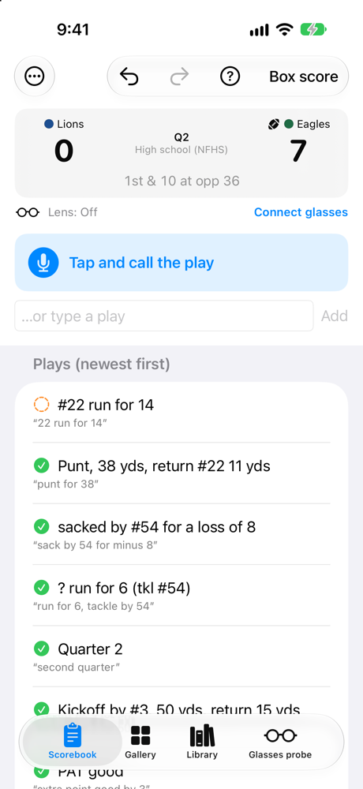
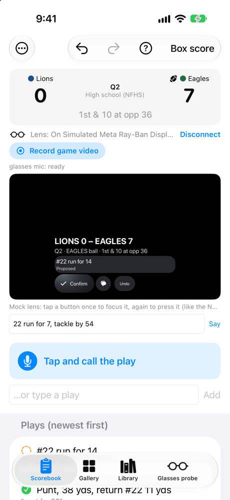
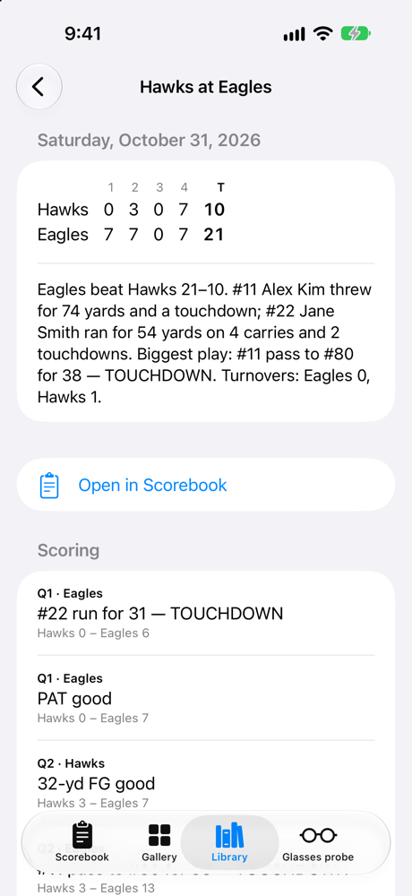
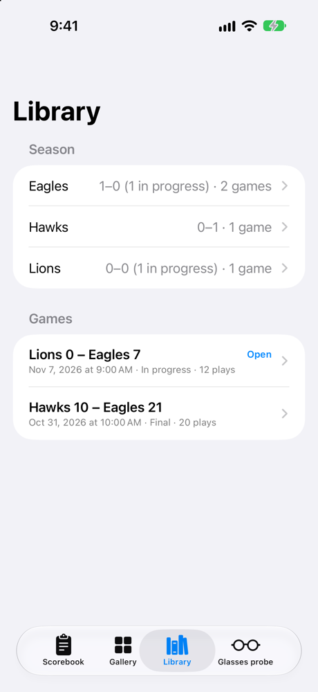
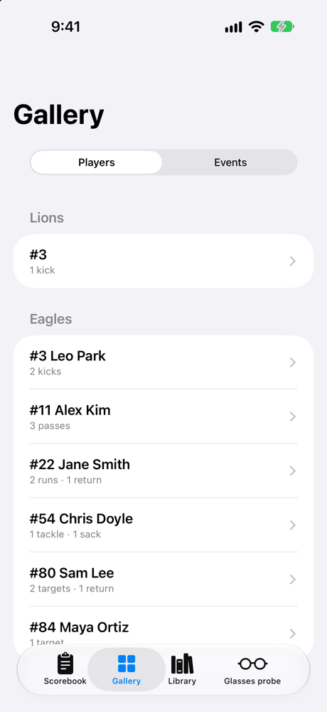

# meta-glasses-sports-stats

Record American football, soccer and baseball games with Meta glasses (Ray-Ban Meta Gen 1–3, Oakley Meta HSTN/Vanguard, Meta Ray-Ban Display), recognize players, extract plays, stats and score, and build a sortable game and highlight library.

- **Plan:** [docs/PLAN.md](docs/PLAN.md)
- **Research report:** [reports/Meta glasses sports stats landscape.md](reports/Meta%20glasses%20sports%20stats%20landscape.md)
- **Raw research notes:** [research_notes/](research_notes/)
- **iOS app (scorebook, Display HUD, game mode, gallery):** [apps/ios/SidelineProbe](apps/ios/SidelineProbe/README.md)
- **Shared Swift core (football model, stats, parser):** [packages/SidelineCore](packages/SidelineCore)
- **Computer vision on recordings (detection, tracking, per-play crops):** [cv/](cv/README.md)

## Screenshots

iOS app in the Simulator with simulated Meta Ray-Ban Display glasses and a demo game.

| Scorebook | Glasses HUD | Game summary | Library | Gallery |
|---|---|---|---|---|
|  |  |  |  |  |
| Call plays by voice or typing; score, down and distance update live. | What the wearer sees on the Display lens; plays can be called and confirmed from the glasses. | Box score, recap and scoring plays, built from the calls. | Every game, plus season records. | Plays by player or event type, with clips and highlight reels. |
